# Architecture Mind Map & Codebase Blueprint: Tools Digital (`adigitaltools.in`)

Ye document Tools Digital website ka complete internal blueprint aur quick-navigation index hai. Iska maqsad ye hai ki future me jab bhi aap koi bhi change bole (jaise color change, naye pages, text updates, buttons, legal policies ya products), toh bina kisi time waste ke direct usi exact file aur line par kaam start ho sake.

---

## 🗺️ 1. High-Level Mind Map (Overview)

```mermaid
graph TD
    Root[adigitaltools.in] --> Core[Core Configs & CI/CD]
    Root --> UI[Live Frontend: index.html]
    Root --> Modules[Sub-Modules & Dedicated Portals]
    Root --> Deploy[Deploy & DevOps Tooling]

    Core --> Pkg[package.json & vite.config]
    Core --> Actions[.github/workflows/deploy.yml]

    UI --> Nav[Navbar & Sticky Header]
    UI --> Hero[Hero: Sub-GHz Telemetry & CTAs]
    UI --> Agri[Agriculture Solutions & 3-Phase Devices]
    UI --> Ind[Industrial Automation & Retrofit Gateway]
    UI --> Apps[Mobile Apps: Attendy & Sudoku Master]
    UI --> Videos[Field Demos & Video Archive]
    UI --> Footer[Legal Center & Contact Footer]

    Modules --> AgritechCatalog[agritech_hardware_devices_catalog/]
    Modules --> AgriMatrix[agritech_overview_problem_solution_matrix/]
    Modules --> FarmerSupport[farmer_support_troubleshooting_hotline/]
    Modules --> FarmerImpact[real_life_farmer_impact_measured_results/]
    Modules --> IndGateway[industrial_iot_gateway_engineering_specification/]
    Modules --> IndCaseStudies[industrial_case_studies_verified_uptime_field_support/]
    Modules --> IndRetrofit[machinery_retrofit_legacy_plant_access/]
    Modules --> AppsAttendy[attendy_attendance_payroll_privacy_policy_data_safety/]
    Modules --> AppsSudoku[sudoku_master_pro_privacy_policy_zero_data_disclosure/]
    Modules --> LegalPortal[google_play_legal_center_app_directory/]
    Modules --> DeletionPortal[account_data_deletion_portal_google_play_compliance/]
```

---

## 🎨 2. Design System, Colors & Typography Tokens

Agar aapko **koi bhi color ya font** change karwana ho, toh saare design tokens `index.html` ke `<script id="tailwind-config">` me defined hain:

### Color Palette (Hex Codes)
| Token Name | Hex Code | Purpose / Usage |
|---|---|---|
| `primary` | `#4fdbc8` | Primary Cyan/Teal accent, glow rings, highlight badges |
| `primary-container` | `#14b8a6` | Main CTA buttons, active tabs, pulse indicators |
| `background` / `surface` | `#0b1326` | Deep Navy/Slate dark theme canvas |
| `surface-container` | `#171f33` | Component cards, telemetry readouts, feature containers |
| `surface-container-high`| `#222a3d` | Hover states, elevated cards |
| `surface-container-lowest`| `#060e20` | Header background, deepest contrast zones |
| `tertiary` | `#7bd8b1` | 3-Phase electrical badges, status meters, green accents |
| `alert-amber` | `#F59E0B` | Warning labels, offline indicators, agricultural alerts |
| `on-surface` | `#dae2fd` | Primary readable white/ice text |
| `on-surface-variant` | `#bbcac6` | Muted subtitle text, specs labels, descriptions |
| `slate-border` | `#334155` | Card borders, dividers, header bottom line |

### Typography Stack
- **Display / Hero Headlines**: `Space Grotesk` (Modern cybernetic / industrial feel)
- **Body & Subtitles**: `Inter` (High legibility on mobile/tablets)
- **Telemetry / Specs / Badges**: `JetBrains Mono` (Terminal / sensor data style)

---

## 🧩 3. Homepage Section Map (`index.html`)

Jab aapko live homepage par koi specific element modify karna ho:

| Section # | Section Name | Elements Inside | Quick Finder |
|---|---|---|---|
| **0** | **Header / Nav** | Logo, Navigation Links (Agriculture, Industrial, Apps, Legal, Contact), Language Toggle (EN/HI/MR), Play Store Link | Search `<header` |
| **1** | **Hero Section** | "Field Telemetry Engine v4.2" badge, Headline, 3 CTA buttons, "Live Field Readout" widget | Search `<!-- SECTION 1: HERO -->` |
| **2** | **AgriTech Hardware** | Radio Pump Controller, Soil Testing Device, Auto Pump Starter cards, 5,000+ farmer stats | Search `id="farmer-solutions"` |
| **3** | **Industrial Precision** | Industrial IoT Gateway, Machinery Retrofit, RS485/Modbus specs, Zero-downtime architecture | Search `id="knowledge-split"` |
| **4** | **Google Play Apps** | Attendy (Payroll/Attendance) & Sudoku Master Pro app cards, Play Store badges, Rating stars | Search `id="play-apps"` |
| **5** | **Field Video Archive** | YouTube video facades (Zero-cookie click-to-load) for farmer tutorials & field demonstrations | Search `<!-- SECTION 5: VIDEO -->` |
| **6** | **Impact & Testimonials** | Real farmer stories, Maharashtra field case study, uptime statistics | Search `<!-- SECTION 6: IMPACT -->` |
| **7** | **Footer & Legal** | Developer page link, Google Play Compliance links (Data Deletion, Privacy Policy, Terms) | Search `<footer` |

---

## 📂 4. Sub-Pages & Dedicated Portals (Pre-Designed Modules)

Aapne jo pehle se designed templates folder me diye hain, unka direct mapping ye hai:

### 🌾 Agriculture Division
- **Problem & Solution Matrix**: `agritech_overview_problem_solution_matrix/code.html`
- **Hardware Catalog**: `agritech_hardware_devices_catalog/code.html`
- **Farmer Support Hotline**: `farmer_support_troubleshooting_hotline/code.html`
- **Impact & Field Results**: `real_life_farmer_impact_measured_results/code.html`

### ⚙️ Industrial Automation Division
- **Architecture Overview**: `industrial_automation_overview_architecture/code.html`
- **IoT Gateway Technical Spec**: `industrial_iot_gateway_engineering_specification/code.html`
- **Legacy Machinery Retrofit**: `machinery_retrofit_legacy_plant_access/code.html`
- **Verified Uptime Case Studies**: `industrial_case_studies_verified_uptime_field_support/code.html`

### 📱 Mobile Apps & Google Play Compliance
- **Apps Catalog**: `tools_digital_mobile_apps_everyday_tools/code.html`
- **Google Play Legal Center**: `google_play_legal_center_app_directory/code.html`
- **Attendy Privacy Policy**: `attendy_attendance_payroll_privacy_policy_data_safety/code.html`
- **Attendy Account Deletion Portal**: `account_data_deletion_portal_google_play_compliance/code.html`
- **Sudoku Master Pro Privacy Policy**: `sudoku_master_pro_privacy_policy_zero_data_disclosure/code.html`

---

## ⚡ 5. Instant Modification Cheatsheet (Quick Actions)

Future me jab bhi aap instruction denge:
1. **"Naya Button ya CTA add karo"**:
   - Seedha targeted section me Tailwind classes ke sath add hoga (`px-5 py-3.5 bg-primary-container hover:bg-primary text-on-primary-container rounded-lg font-semibold`).
2. **"Naya Page create karo"** (Jaise `/agriculture/products.html` ya `/legal/privacy.html`):
   - Module directory se code lekar root/target path me link karenge, nav me add karenge aur build verify karenge.
3. **"Text / Price / Image badlo"**:
   - Exact component search karke text swap hoga.
4. **"Deploy to Live"**:
   - Hum change execute karenge, local test verify karenge, commit karke `git push origin main` karenge.
   - **2 minute ke andar live `https://adigitaltools.in` par update aa jayega!**

---
*Created for instant context recall across sessions.*